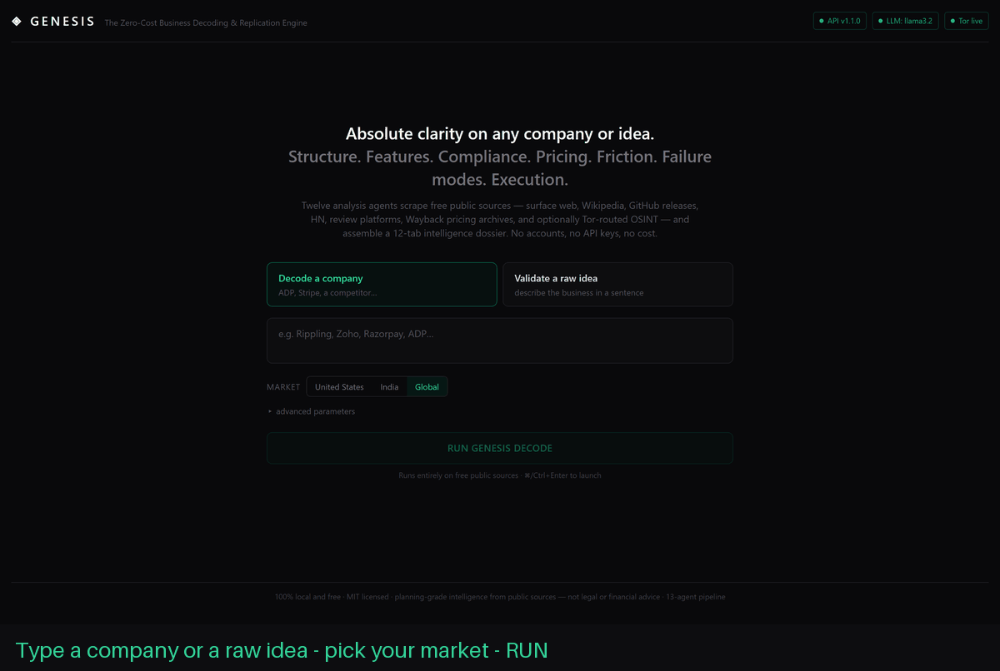
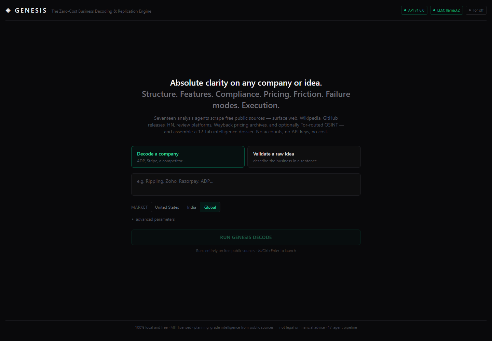
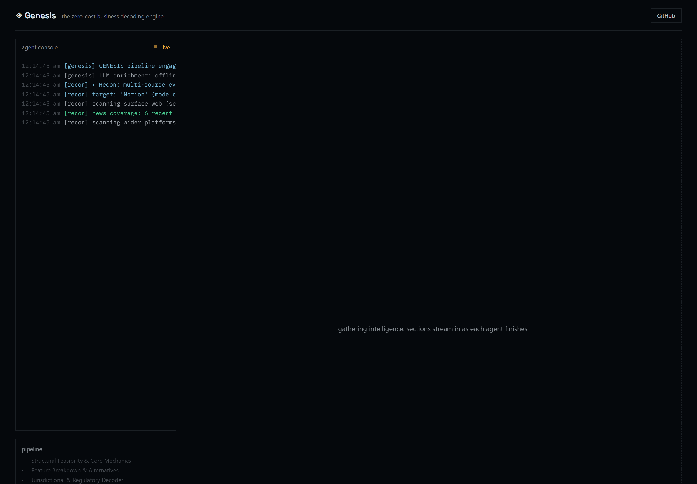
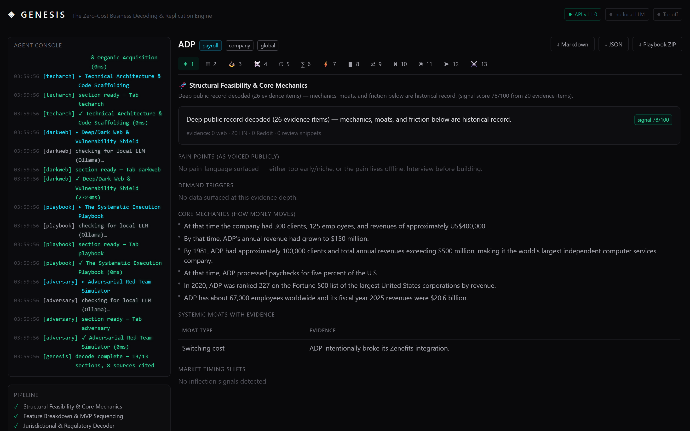
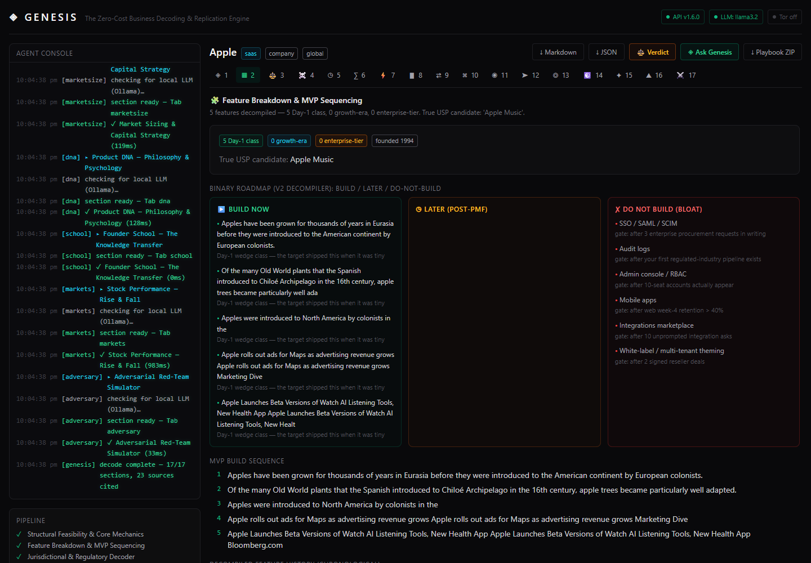
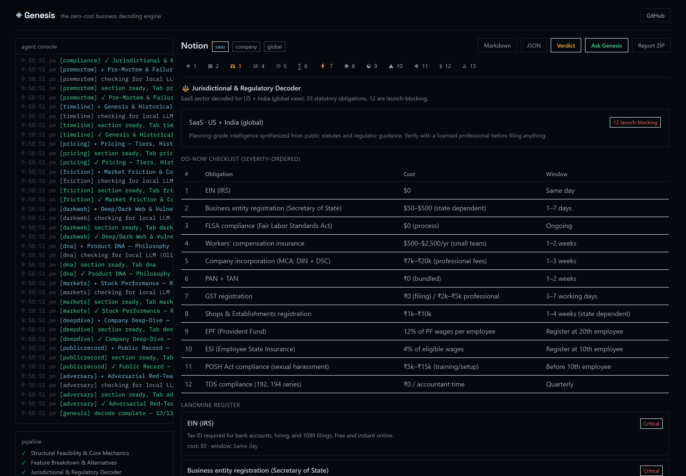
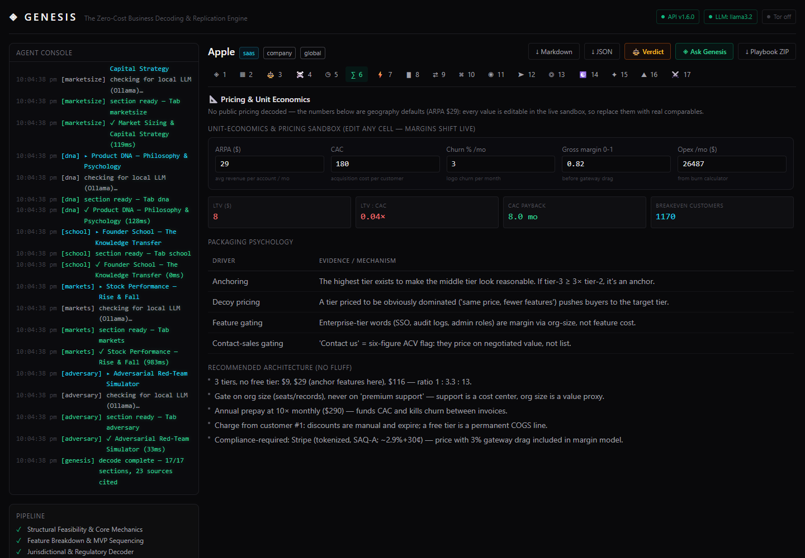
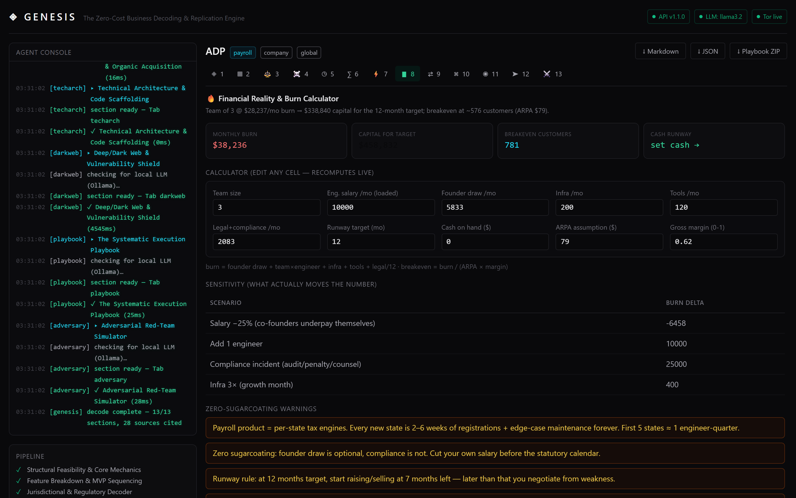
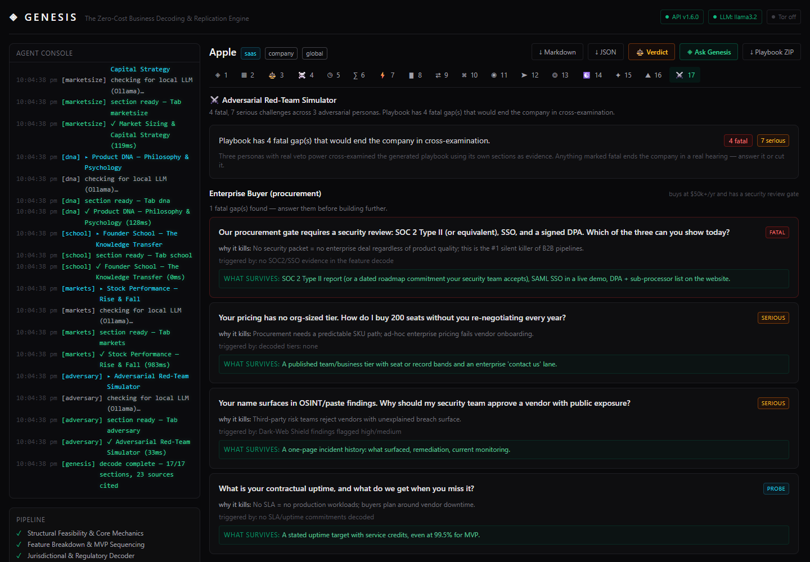

# ◈ GENESIS — The Zero-Cost Business Decoding & Replication Engine

Free, MIT-licensed, no API keys. Everything runs on your machine.

[](https://github.com/amanvicky/Genesis-Business-Decoding-Engine/actions/workflows/ci.yml)
[](LICENSE)


<p align="center">
  
</p>

Give it a company (ADP, Stripe, Razorpay, your competitor) or a rough idea, and it
returns a 13-tab dossier: whether the model holds up, the features worth copying and
the ones to skip, the compliance traps per state or state-code, why similar companies
died, real revenue history from SEC filings, pricing math you can edit live, what
users actually complain about, burn and runway numbers, channels that cost nothing,
starter code, and a red-team panel that argues with the playbook. Every claim links
its source.

## Quickstart

Python 3.10+ and Node 18+. Then:

```bash
python genesis.py
```

(Windows: `start.bat` runs exactly this.)

First run installs the backend venv, frontend packages, and a production build.
Everything then runs detached in the background — close the terminal, it keeps
going. A watchdog restarts crashed services. If Tor is installed it starts a
client-only SOCKS5 proxy on 127.0.0.1:9050; if not, everything still works and
Tab 11 just uses clearnet sources.

```bash
python genesis.py status     # what's running, on which port, healthy or not
python genesis.py logs api   # tail api|web|tor|watchdog logs
python genesis.py stop       # shut it all down
python genesis.py doctor     # pre-flight check (deps, ports, tor, ollama)
```

Flags: `--dev` (hot reload), `--no-tor`, `--no-watchdog`, `--no-browser`, `--rebuild`.

Then open http://localhost:3000, type a company, hit RUN.

## Screenshots

Captured live from the app. Reproduce any of it with the commands in
[proofs/](proofs/README.md).

Input panel — company or idea, India / US / Global, advanced params:



The agent console streams every step — surface search, Wikipedia, SEC EDGAR, news
archives. Here a full 13/13 decode of ADP just completed:



Structural verdict with moat evidence and a signal score:



Feature Decompiler v2 — build now, build later, and enterprise bloat with the gate
that reopens it:



Compliance decoder with a 16-state payroll matrix and the India statutory stack:



Pricing tab with an interactive sandbox — change CAC, churn, margin, or tier prices
and LTV/CAC/payback/breakeven recompute instantly:



Burn calculator — runway math that includes what compliance actually costs:



And the red-team panel: an enterprise buyer, a skeptical VC, and a regulatory
auditor attack the playbook using its own sections as evidence:



## What the 13 agents produce

| # | Tab | What you get |
|---|-----|--------------|
| 1 | **Structural Feasibility & Core Mechanics** | Pain points from public voices, demand triggers, how money moves, moats with evidence, timing shifts, signal score |
| 2 | **Feature Breakdown & MVP Sequencing** | Chronological feature history (GitHub releases + Wikipedia), day-1 vs growth vs enterprise classification, USP mining, binary build/skip roadmap |
| 3 | **Jurisdictional & Regulatory Decoder** | US federal + 16-state payroll matrix, India statutory stack (GST, EPF/ESI, POSH, DPDP, Labour Codes), sector licenses (RBI PA, MTL, HIPAA), costed checklist |
| 4 | **Pre-Mortem & Failure Post-Mortems** | 22 failure records (Zenefits, Fast, MoviePass, LendUp…) matched to your domain, dominant death patterns, live-searched shutdown reports |
| 5 | **Genesis & Historical Timeline** | Milestones, pivots, funding events, annual revenue from SEC 10-K filings. Idea mode: execution gates with kill criteria instead of fake dates |
| 6 | **Pricing & Unit Economics** | Tier extraction, Wayback Machine pricing history, ARPA → LTV → LTV:CAC → payback with visible formulas, packaging-psychology notes |
| 7 | **Market Friction & Consumer Psychology** | Reddit/HN/review mining into complaint clusters with shares, quotes with links, demand triggers |
| 8 | **Financial Reality & Burn Calculator** | Geography-adjusted salaries, monthly burn → capital needed → breakeven customers, editable calculator, sensitivity table |
| 9 | **Unfair Distribution & Organic Acquisition** | 12 zero-cost channels as repeatable loops, ranked by sector and geography, each with concrete first actions |
| 10 | **Technical Architecture & Code Scaffolding** | Stack decisions per sector, generated starter files (FastAPI, Postgres schema, Next.js page, idempotent webhook, GST/OT calculators) — included in the ZIP |
| 11 | **Deep/Dark Web & Vulnerability Shield** | Passive OSINT via the Ahmia onion index, search-indexed paste chatter, HIBP breach corpus. Read-only, no marketplaces, illegal queries refused |
| 12 | **The Systematic Execution Playbook** | 6 phases, gateway/KYC friction per gateway, KYC document pack, scaling hurdles, kill criteria |
| 13 | **Adversarial Red-Team Simulator** | The three-persona panel described above; fatal gaps must be answered or cut |

Every section links its sources, and a blocked source degrades its own section
rather than killing the run.

## How it stays free

| Source | Feeds | Why free |
|--------|-------|----------|
| DuckDuckGo lite/html → SearXNG → Mojeek → Google/Bing News RSS | Surface-web evidence | Keyless public endpoints with automatic fallback |
| Wikipedia API | Genesis, history, founding year | Free API |
| HN Algolia | Developer sentiment | Free API |
| Reddit JSON | Consumer complaints | Free (rate-limited, degrades softly) |
| GitHub API | Release changelogs → feature decompiler | Free unauthenticated tier |
| Wayback Machine CDX | Historical pricing snapshots | Free archive |
| Trustpilot / G2 / Capterra | Review intel via search snippets only | Public search results, no ToS-violating scraping |
| SEC EDGAR (tickers, submissions, XBRL) | Revenue history, 10-K filings | Free, keyless US-government API |
| Have I Been Pwned + Ahmia | Breach shield, onion index (Tab 11) | Free endpoints |

Politeness: honest User-Agent, bounded retries, concurrency limit, backoff, and a
session-level engine cache so a blocked engine is skipped rather than hammered.

Optional local layers (never required): [Ollama](https://ollama.com) sharpens the
narrative of each section (`ollama pull llama3.2`), and Tor adds anonymity routing
for Tab 11. See [Configuration](#configuration).

## Notes on the build

- Streaming: `POST /api/analyze/stream` emits NDJSON — `log` events feed the
  console, `section` events fill tabs as they finish, `done` carries the report.
- Exports: `POST /api/export/markdown`, `/json` (schema `genesis.report/v1`), `/zip`
  (report + generated scaffold + embedded JSON).
- The deterministic core does the real analysis from evidence + curated knowledge
  bases (compliance statutes, failure records, channel DB). Ollama only adds
  narrative on top, so nothing depends on a model being present.
- The frontend types the whole stream as a discriminated union (`ConsoleEvent`)
  with per-tab payloads via `SectionDataMap`, compiled under strict TypeScript.

## Project structure

```
genesis.py               service manager: install · run · supervise · stop (std lib only)
start.bat / start.sh     thin launchers → genesis.py
backend/
  app/
    main.py               FastAPI app (stream, health, md/json/zip exports)
    pipeline.py           recon → 13 agents + cross-section post-processing
    models.py             request/report/evidence models
    text.py               keyphrases, money/tier extraction, feature classification
    llm.py                optional Ollama bridge (fails soft)
    export.py             Markdown + schema-versioned JSON + ZIP builders
    engines/triangulation.py   subject identity (kills acronym collisions)
    scrapers/             search cascade, wikipedia, hn, reddit, github,
                          wayback, reviews, filings (SEC EDGAR), tor
    agents/               recon + 13 analysis agents (incl. adversary red-team)
    data/                 compliance KB (US + India), failure records, channels, scaffolds
  scripts/smoke_test.py   offline pipeline verification
frontend/
  app/                    layout, page (state machine)
  components/             InputPanel, AgentConsole, ReportViewer, ui atoms
  components/tabs/        the 13 typed tab renderers
  lib/                    types.ts (wire contract), api.ts (NDJSON client)
.github/workflows/ci.yml  offline 13/13 test + strict build on every push
proofs/                   reproducible evidence (see proofs/README.md)
```

## Configuration

Copy `backend/.env.example` → `backend/.env` if you want to change anything:

| Variable | Default | Effect |
|----------|---------|--------|
| `GENESIS_OFFLINE` | `0` | `1` skips all network calls; runs on built-in knowledge bases only (also used by CI) |
| `OLLAMA_URL` | `http://127.0.0.1:11434` | Local LLM endpoint; each section gets a narrative pass when present |
| `GENESIS_LLM_MODEL` | `llama3.2` | Any Ollama model you've pulled |
| `TOR_PROXY` | `socks5://127.0.0.1:9050` | SOCKS5 proxy for Tab 11 |
| `TOR_ENABLED` | `1` | `0` disables the Tor probe entirely |

Tor install: [Expert Bundle](https://www.torproject.org/download/tor/) on Windows
(`tor.exe --SocksPort 9050`), `brew install tor` on macOS, `apt install tor` on
Linux. The service manager starts it for you if it's on disk. Frontend API URL:
set `NEXT_PUBLIC_API_URL` in `frontend/.env.local` (see `.env.local.example`).

Manual install, if you'd rather not use the manager:

```bash
# backend
cd backend
python -m venv .venv
.venv/Scripts/python -m pip install -r requirements.txt      # Windows
# .venv/bin/python -m pip install -r requirements.txt        # macOS/Linux
.venv/Scripts/python -m uvicorn app.main:app --port 8000

# frontend (second terminal)
cd frontend
npm install
npm run build && npm start        # or: npm run dev
```

## FAQ

**API keys or accounts?**
None. Every source is keyless — Wikipedia, SEC EDGAR, news RSS, HN, Reddit, GitHub,
Wayback, review snippets, HIBP. Optional local layers are Ollama and Tor.

**Is the dark-web module legal?**
It reads the Ahmia onion index, search-indexed paste boards, and the free HIBP
breach corpus. Passive and read-only: no marketplaces, no credentials, no
interaction, illegal queries refused, and it only launches an already-installed
Tor binary as a plain client.

**Windows / macOS / Linux?**
Anywhere Python 3.10+ and Node 18+ run. The manager handles the rest.

**How accurate is it?**
Revenue figures come from audited SEC filings where they exist; everything else is
planning-grade synthesis from public sources, with sources linked per claim. Each
section states its evidence depth. Not legal or financial advice.

**Where does my data go?**
Nowhere. Everything runs locally; the only outbound traffic is reading public
sources, and reports stay on your disk.

**Commercial use?**
MIT, output is yours. Don't present the compliance notes as legal advice.

## Roadmap

- v1.2: India MCA/filings layer · changelog and blog scrapers for private companies · report diffing between runs
- v1.3: tested Docker images · scheduled re-decodes with drift alerts
- Ongoing: more states and sectors in the compliance KB, more failure records

PRs welcome — see [CONTRIBUTING.md](CONTRIBUTING.md). Highest-value contributions
are knowledge-base rows (compliance items, failure records, channels) with sources.

## Known issues

| Symptom | Cause / fix |
|---------|-------------|
| `API offline` in the header | Backend down — `python genesis.py status`, then `python genesis.py` |
| `surface web: 0 results` | Search engines rate-limiting your IP; the cascade falls back to Wikipedia/HN/EDGAR/news and the report degrades gracefully |
| Reddit: `0 posts` | Reddit rate-limits unauthenticated JSON; friction analysis leans on HN + review snippets |
| Tab 11 says `clearnet-degraded` | Tor isn't running; install it or ignore — the module uses clearnet OSINT |
| Port already in use | `python genesis.py stop` clears processes belonging to this project; foreign apps are never touched |

## License

MIT — see [LICENSE](LICENSE). No paid tiers, no telemetry, no accounts.
