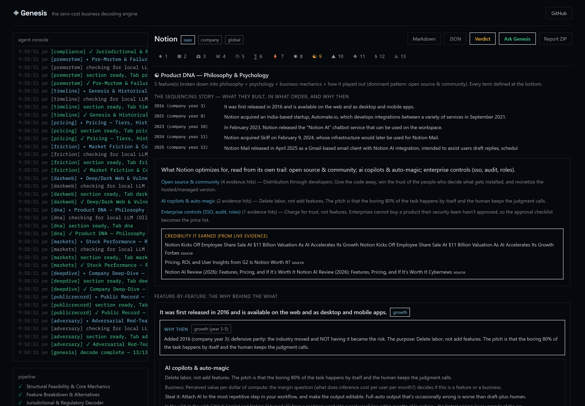
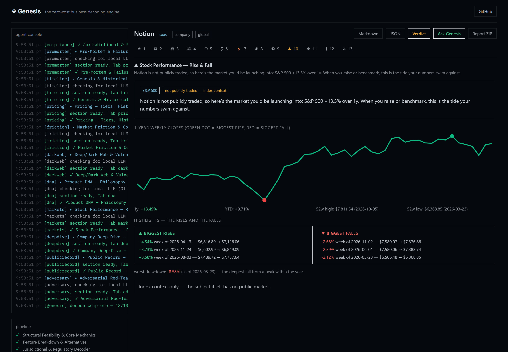
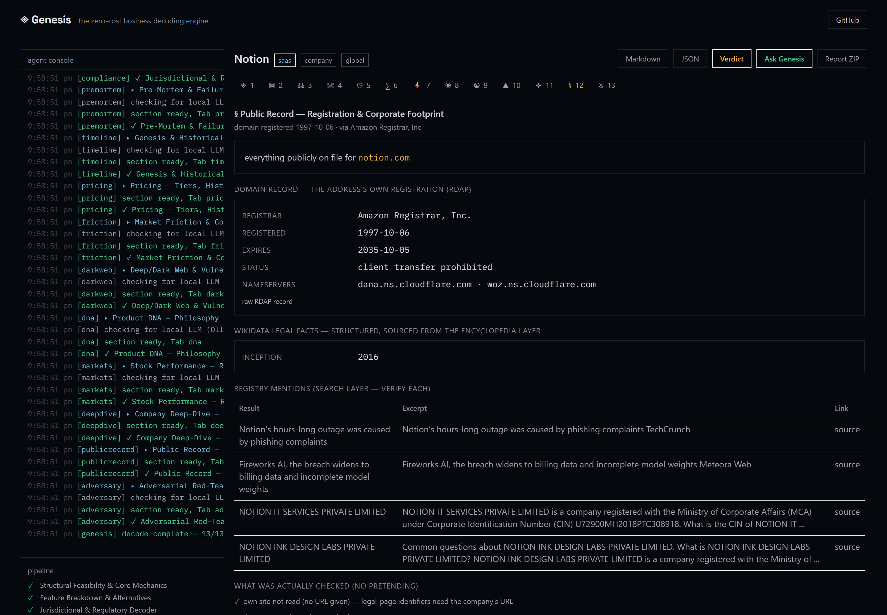
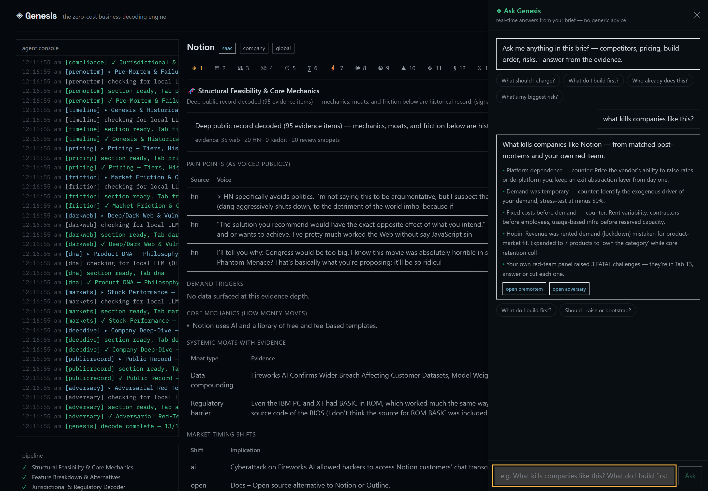
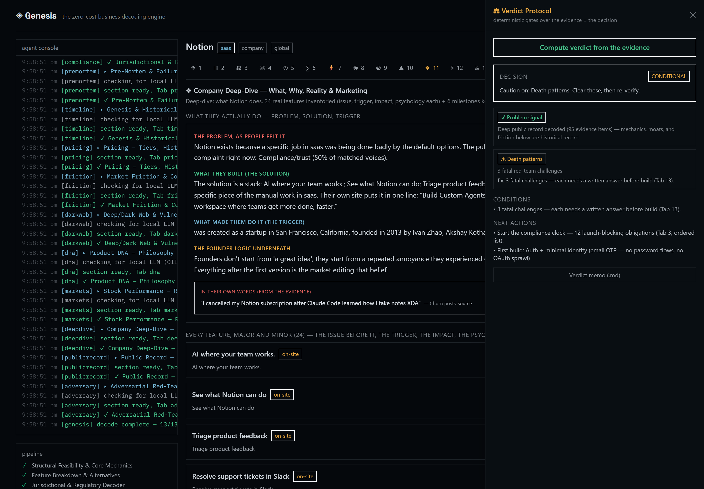
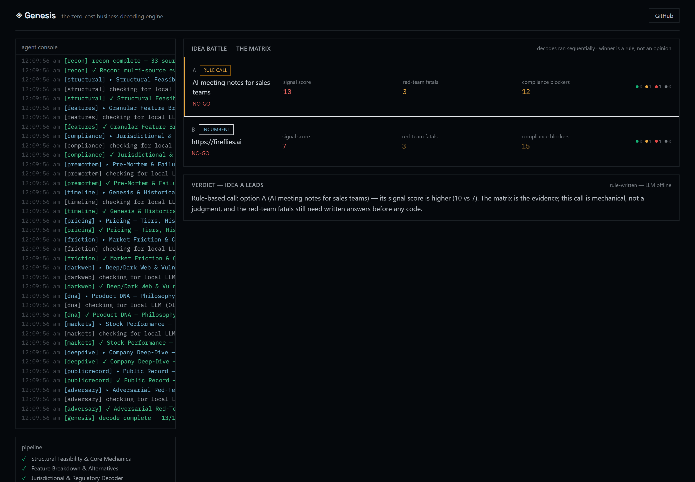

# GENESIS

[](https://github.com/amanvicky/Genesis-Business-Decoding-Engine/actions/workflows/ci.yml)


[](LICENSE)

Feed it a company name, its website URL, or just a rough idea.
It comes back with a 13-tab research brief — every tab a dossier about the subject:
does the model hold up, what features they shipped and when, the compliance traps
(per country/state), why companies like this died, real revenue from SEC filings,
the registration layer (CIN/GSTIN/VAT from the company's own legal pages, RDAP
domain records, EDGAR registration fields), the pricing they actually charge, what
users complain about, and a red-team panel that argues with the plan. Every claim
links its source. No calculators, no coaching — research only.

And when you're done reading, there's a chat panel that answers questions using
your own numbers ("should I raise?", "who already does this?") and a verdict
protocol that forces a GO / NO-GO call so the brief actually ends in a decision.
Every decode is stored in a local `briefs/` vault, so you can also battle 2-3 raw
ideas against each other on a deterministic matrix and then watch the winner for
real-world drift.

No API keys. No accounts. Nothing leaves your machine.

<p align="center">
  
</p>

## Run it

**One paste (no download step):** copy this line and paste it into PowerShell —
Genesis downloads itself from the repo link, installs everything hidden into
your user folder, and opens the dashboard by itself:

```powershell
irm https://raw.githubusercontent.com/amanvicky/Genesis-Business-Decoding-Engine/main/scripts/install_from_web.ps1 | iex
```

**Windows installer (same result, classic wizard):** grab `Genesis-1.14.0-Setup.exe` from
[Releases](https://github.com/amanvicky/Genesis-Business-Decoding-Engine/releases)
and double-click it. Standard wizard, installs into your user folder — no admin,
no PATH changes, nothing outside its own directory. After the wizard, Genesis
finishes preparing itself **in the background** (private Python and Node are
downloaded into the app folder if missing, dependencies install, first build) —
no console, nothing to click — and the dashboard window opens by itself when
everything is ready. A few minutes, once. After that: Start menu → **Genesis**.
Uninstall from Apps & Features like any other app, or just delete the folder.

**Free cloud demo (nothing to install):** a hosted, evidence-thin instance of
the dashboard — see [deploy/HF_STEPS.md](deploy/HF_STEPS.md) to spin one up on
a free Hugging Face Space in ~10 minutes.

**From a plain folder** (zip or `git clone`): double-click **`Genesis Setup.bat`** —
same deal, everything private to the folder. Day-to-day launcher: **`Genesis.bat`**
(no terminal after setup; the console only shows up for first-run installs).

**Already have Python 3.10+ and Node 18+:**

```bash
python genesis.py
```

First run installs the venv, npm packages and a production build, then everything
runs in the background (close the terminal, it keeps going). A watchdog restarts
crashed stuff. Then open http://localhost:3000, type a company, hit RUN.

```bash
python genesis.py status     # what's running
python genesis.py logs api   # tail logs
python genesis.py stop       # shut it down
python genesis.py doctor     # pre-flight check
python genesis.py watch      # re-check watched briefs now (drift memos in briefs/)
python genesis.py uninstall  # stop + clean up (--deep removes venv/node_modules too)
```

Flags if you want them: `--dev`, `--no-tor`, `--no-watchdog`, `--no-browser`, `--rebuild`.

Optional extras: the installer's **Privacy layer (Tor)** checkbox downloads the
official Tor client into the app folder (client-only, Tab 11 stays clearnet-degraded
without it). **Ollama** is detected if you already run it locally — it's never
auto-installed (multi-GB, runs its own service); without it the engine is fully
deterministic and every tab still works.


## Proof it's real

Every screenshot below is a genuine capture of the running app (regenerate them
yourself with [proofs/capture.mjs](proofs/capture.mjs) — 14 shots, one command).

Landing. Decode a company, a raw idea, or battle both:


The agent console mid-decode — every step streams:


Structural verdict, and the compliance decoder:


Product DNA — the philosophy and psychology behind every feature:



Stock performance and the public record (filings, registration, domain):




Ask Genesis (answers from your brief) and Verdict Protocol v2 (two research
gates, no quiz):




The idea battle — a raw idea against the incumbent's URL, winner by rule:



The full set (pre-mortems, observed pricing, red-team and more) lives in
[proofs/](proofs/).

## The 13 tabs, quickly

1. **Structural** - pain points, demand triggers, moats, a signal score
2. **Features** - the shipped feature trail (dated, sourced) + the alternatives scan
3. **Compliance** - US federal + 16-state payroll matrix, India statutory stack (GST, EPF/ESI, DPDP...), costed checklist
4. **Pre-mortem** - 22 real failure records (Zenefits, MoviePass, Fast...) matched to your domain
5. **Timeline** - milestones, funding events and revenue history from SEC filings; idea mode gets execution gates with kill criteria instead of fake dates
6. **Pricing** - the tiers they actually charge, Wayback pricing history, packaging psychology
7. **Friction** - what users actually complain about (Reddit/HN/review mining)
8. **Dark web shield** - passive OSINT via Ahmia + HIBP, read-only, illegal queries refused
9. **Product DNA** - the philosophy and psychology behind every feature, every term explained in plain words
10. **Stock performance** - 1-year chart, 52-week range, biggest weekly rises and falls, max drawdown (private companies get the market index as context)
11. **Company deep-dive** - what the company actually does (problem in users' own words → solution → founding trigger), every feature mined from the company's own site + release trail with the issue people had before it, the reality check, and the concrete marketing mechanics they use
12. **Public record** - the legal layer: CIN/GSTIN/VAT/company numbers scraped from the company's own legal pages, the domain's RDAP registration record, SEC EDGAR registration fields, Wikidata legal facts — with honest coverage notes for registries that have no open API
13. **Red team** - an enterprise buyer, a skeptical VC and a regulator attack the plan

Every section links its sources. If a source is blocked, that one section degrades,
the rest of the run continues. If a source is blocked, that one section degrades,
the rest of the run continues.

## Battle your ideas, then watch the winner

The input panel has a fourth mode: **Battle ideas**. Give it 2-3 slots — each can
be a raw idea, an existing company by name, or a rival's website URL — they decode
one after another (never parallel, search engines ban that from one IP) — and you
get a matrix per option: signal score, verdict call, red-team fatals, compliance
blockers. Battling your idea against the incumbent's URL is
the honest question: does the rival already out-position you, and where exactly? The winner is a rule (gate tier → signal
score → fatals → blockers), never an LLM opinion; a full tie resolves
to PENDING instead of a coin flip. The local model, when present, writes one
paragraph of verdict prose — the call itself stays mechanical.

Every decode — battle or not — lands in the `briefs/` vault (JSON + a markdown
twin, 3 kept per subject). Hit **watch this subject** after a decode and the brief
re-decodes itself every 7 days: when the dashboard opens past the interval the
backend re-runs the pipeline headless, diffs ~10 stable fields (legal name,
registration no, registered office, registrar, tech stack, emails, socials,
signal score, fatals, compliance blockers) against the
stored memo, and alerts on three tiers — a silent `logs/watch.log` line always, a
`drift_*.md` memo next to the brief on a real change, and a drift chip on the
dashboard with a per-tab panel. Ideas can't be watched (they have no stable
identity to re-check); checks also run manually:

```bash
python genesis.py watch          # re-check what's due now
python genesis.py watch --force  # check every watched brief, ignore intervals
```

Thresholds are deliberately strict so evidence noise (a search engine serving a
different result count) never triggers a memo: the signal score must move by 5+
points, and a value merely appearing or vanishing (better scraping, or a fetch
hiccup) stays silent. Delete the `briefs/` folder to reset
the whole history — nothing else stores it.

## Why it's free

Everything runs on keyless public endpoints: DuckDuckGo/Bing/SearXNG/Mojeek for search,
Wikipedia, HN Algolia, Reddit JSON, GitHub API, Wayback Machine, SEC EDGAR, RDAP
(domain registration records), GDELT (global magazine/press coverage), LinkedIn
posts and Medium/Substack essays as the open web indexes them, Have I Been Pwned,
review snippets from search results — plus the company's own website whenever you
give Genesis the URL.
Honest User-Agent, bounded retries, backoff, and a blocked engine gets skipped
instead of hammered.

Optional local extras (never required): [Ollama](https://ollama.com) sharpens the
writing of each section, Tor routes Tab 11 through SOCKS5.

## How it works

- `POST /api/analyze/stream` streams NDJSON: `log` events feed the console,
  `section` events fill tabs as they finish, `done` carries the report.
- The real analysis is deterministic, built on curated knowledge bases (compliance
  statutes, failure records, channel DB). Ollama only polishes prose, so nothing
  depends on a model being present.
- Exports: markdown, schema-versioned JSON, and a ZIP with generated scaffold code.

## Project structure

```
genesis.py               service manager (install / run / supervise / stop), stdlib only
backend/app/
  main.py                FastAPI app (stream, battle, vault, watch, health, advisor, verdict, exports)
  pipeline.py            recon -> 13 agents
  battle.py              idea battle: sequential decodes, matrix, rule-based winner
  fields.py              the stable-field extractor battle/vault/watch stand on
  vault.py               the briefs/ vault (JSON + markdown twin, cap 3 per subject)
  watch.py               lazy re-decode + drift alerts (log / memo / chip)
  models.py              request/report/evidence models
  text.py                keyphrases, money/tier extraction, feature classification
  advise.py              real-time advisor (answers from your own brief)
  verdict.py             the GO / NO-GO decision protocol
  engines/               subject identity (kills acronym collisions)
  scrapers/              search cascade, wikipedia, hn, reddit, github, wayback, filings, tor
  agents/                recon + 13 analysis agents (planning agents cut in 1.14)
  data/                  compliance KB (US + India), failure records, channels, scaffolds
frontend/                Next.js 14, strict TS, one typed renderer per tab
.github/workflows/       offline tests + strict build on every push
```

## Tests

I got tired of breaking things by hand, so:

```bash
cd backend && .venv/Scripts/python -m pytest tests -q     # ~450 offline tests
python scripts/smoke_test.py                              # 14/14 sections, no network
python tests_e2e/lifecycle_test.py                        # the service manager, all lifecycle stages
python tests_e2e/live_functional_test.py                  # live HTTP journey (stack must be running)
```

CI runs the pytest suite + strict frontend build on every push.

## Config

Copy `backend/.env.example` to `backend/.env`:

| Variable | Default | What it does |
|----------|---------|--------------|
| `GENESIS_OFFLINE` | `0` | `1` = no network at all, runs on the built-in KBs (CI uses this) |
| `OLLAMA_URL` | `http://127.0.0.1:11434` | local LLM endpoint, optional |
| `GENESIS_LLM_MODEL` | `llama3.2` | any model you've pulled |
| `TOR_PROXY` | `socks5://127.0.0.1:9050` | SOCKS5 for tab 11 |
| `TOR_ENABLED` | `1` | `0` disables the tor probe |

## Known issues

- `API offline` in the header: backend died, check `python genesis.py status`
- `surface web: 0 results`: search engines rate-limiting your IP, the cascade
  falls back to Wikipedia/HN/EDGAR and the report degrades but works
- Reddit gives `0 posts`: reddit rate-limits unauthenticated JSON, it is what it is
- Tab 11 says `clearnet-degraded`: no Tor installed — tick the installer's
  Privacy layer checkbox, or drop a tor.exe into `runtime\tor\` yourself
- Port already in use: `python genesis.py stop` only clears this project's
  processes, it never touches foreign apps
- Watch checks run when the dashboard opens past an interval (or via
  `python genesis.py watch`) — nothing pings anything while Genesis is closed

## License

MIT. Output is yours. Don't present the compliance notes as legal advice.
